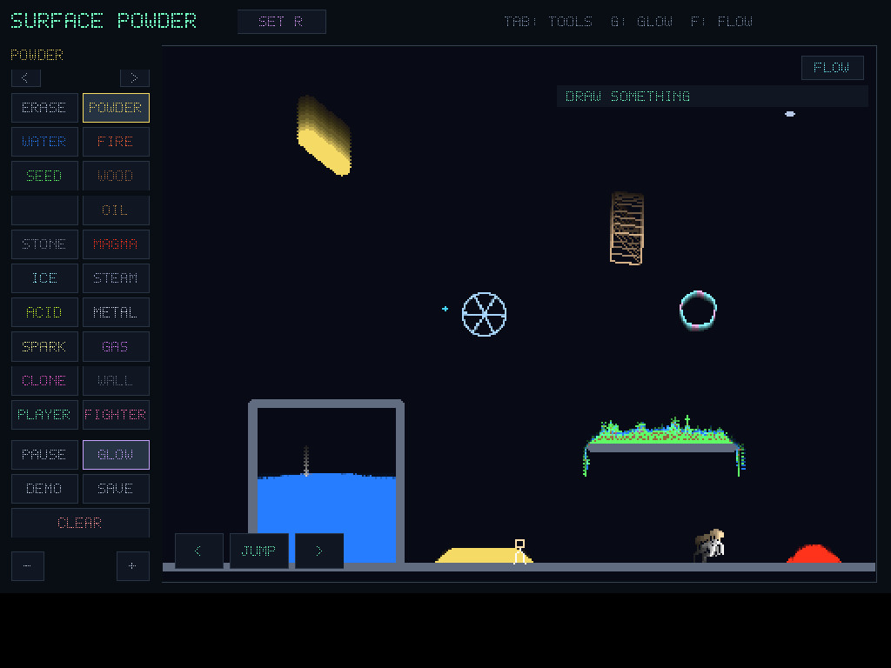
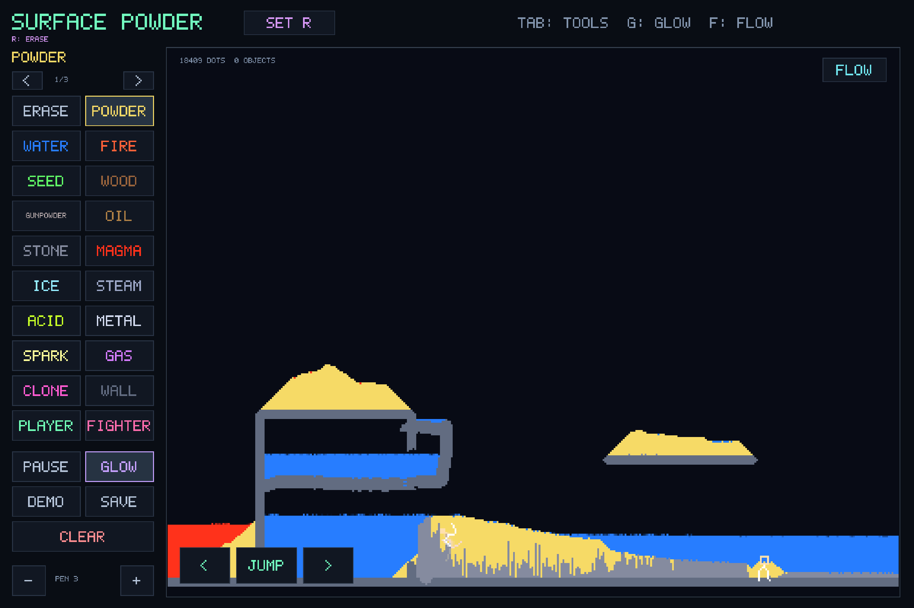
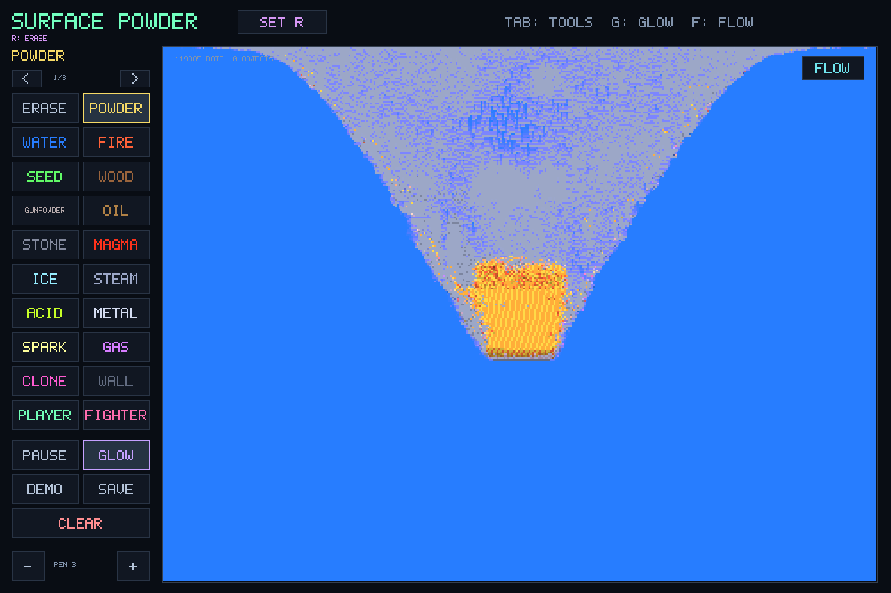

# Surface Powder

A small, native falling-sand sandbox written in Rust and SDL2. Pour powder,
water, fire and other materials into a world of glowing particles, growing
plants, explosions and little stickmen.

Inspired by [DAN-BALL Powder Game](https://dan-ball.jp/en/javagame/dust/).
This is an independent implementation with its own code and visuals; it does
not include the original game's source or assets.

## Screenshots

The starter scene includes a fan-driven wheel, a tumbling box, a bubble,
water, growing plants and jointed stickmen.



Native gameplay on the Surface Pro 4, with touch controls and a saved sandbox scene.



## Features

- 400×300 simulation with **50 materials and tools**, arranged across three palette pages.
- Momentum-carrying wind and pressure waves with smooth sampling and obstacle deflection.
- Directional fans and pumps; explosions throw particles, bodies and characters outward.
- Anchored spinning wheels, tumbling boxes, material-carrying balls, and floating bubbles.
- Six-joint players and fighters with foot-driven movement, floppy limbs and flying, shrinking body fragments on elimination.
- Brush sizing, neon trails, airflow view, touch controls, and an interactive starter scene.
- Automatic scene persistence, including wind and object state.
- Physics runs on its own worker targeting 60 Hz, independently of input and rendering. Rendering synchronizes to the display refresh rate (60 Hz on the Surface), with a 60 FPS fallback.
- No browser, game engine, account or network connection required to play.

The palette includes powder, water, fire, seeds, gunpowder, fans, ice,
superballs, clones, fireworks, oil, C-4, stone, magma, virus, nitro, ants,
torches, gas, soapy water, thunder, metal, bombs, lasers, acid, vines, salt,
glass, birds, mercury, sparks, fuses, clouds and pumps, plus wood, steam,
saltwater and snow. Tools include Wind, Air, Drag, Bubble, Wheel, Player,
Fighter, Box, Ball, Create, Wall and Erase.

This remains an independent approximation of the original. Air uses 4-pixel
tiles and particles use grid collisions, box-to-box collision uses conservative bounding circles, and bubbles
use a deforming film rather than sealed fluid volumes. Create currently
reuses the clone material behavior. Original saves, online sharing, copy/paste
and the original game's complete UI/interaction rules are not supported.

## Build and run

Requires Rust 1.85 or newer and the SDL2 development library. Linux and macOS
are supported; Linux Wayland has been tested on a Surface Pro 4.

### Debian / Ubuntu

Install [Rust](https://www.rust-lang.org/tools/install), then:

```sh
sudo apt-get install build-essential pkg-config libsdl2-dev
git clone https://github.com/Gorskiz/surface-powder.git
cd surface-powder
cargo run --release --locked
```

### macOS

With Rust and Homebrew installed:

```sh
brew install sdl2
git clone https://github.com/Gorskiz/surface-powder.git
cd surface-powder
RUSTFLAGS="-L native=$(brew --prefix sdl2)/lib" cargo run --release --locked
```

## Controls

| Input | Action |
| --- | --- |
| Touch, pen or left mouse drag | Paint selected material |
| Right mouse drag | Paint secondary material (Erase by default) |
| Set R, then a palette material | Choose secondary material using touch |
| Right-click a palette material | Choose secondary material using a mouse |
| Palette ‹ / ›, Tab, Page Up / Page Down | Browse palette pages |
| F / Flow | Show air velocity and pressure |
| Mouse wheel or − / + | Change brush size |
| Arrow keys or A / D / W | Move and jump with player stickmen |
| On-screen arrows / Jump | Touch controls for stickmen |
| Space / Pause | Pause or resume |
| G / Glow | Toggle trails |
| Save | Save the current scene |
| Clear, twice within three seconds | Clear the world |
| Demo | Replace the current scene with the starter scene |
| Escape | Save and exit |

Player, Fighter, Wheel, Box and Ball create one object per press. Draw a loop
with Bubble and release to create a sized bubble. Drag the rim of a wheel to
spin it, or drag a box/ball to throw it. Wind follows the direction of your
stroke; a held stationary wind brush keeps blowing in that direction. Fans
and pumps take their direction from the stroke used to place them.

Air raises pressure; right-clicking with Air lowers it. On touch, use the
Air + / Air − button beside Flow to switch between pressure and suction. Set R chooses a
material payload for subsequently placed fireworks and balls, as well as the
right mouse brush. Selecting Erase as the secondary resets payloads to powder.
Fireworks launch when ignited; balls release their payload on impact. Gunpowder, C4 and nitro throw existing grains outward; gas mostly ignites and adds pressure. Bomb instead pulls a small cloud inward before the affected grains decay. The
Flow overlay shows velocity arrows, green positive pressure and blue negative
pressure. The default demo includes a fan-driven gear and movable objects.

The Demo button
replaces the current world immediately; it is not an additional save slot.

## Saves

The scene saves every 30 seconds, when you press Save, and on normal exit,
SIGINT or SIGTERM. It reloads at startup.

Default location: `~/.local/state/surface-powder/world.bin`. Setting
`XDG_STATE_HOME` moves it to `$XDG_STATE_HOME/surface-powder/world.bin`.
Version 1 saves load automatically; the first upgraded save creates a
`world.bin.v1.bak` copy. Version 2 saves retain pressure, velocity, bodies and
material payloads. Version 3 adds character joints, death fragments and particle momentum.
Both older versions load automatically and receive a versioned backup before upgrading. Corrupt or incompatible saves are preserved and reported rather than
overwritten. To start fresh, move the save file aside.

## Development

```sh
cargo test --locked
cargo fmt --check
cargo clippy --locked -- -D warnings
cargo run --release --locked -- --benchmark
cargo run --release --locked -- --benchmark-stress
cargo run --release --locked -- --benchmark-dense
```

On macOS, use the same `RUSTFLAGS` setting from the build command for commands
that link the executable. Tests cover articulated movement and fragmentation, particle momentum and conservation,
barriers, wind transport, pressure waves, wheel torque,
body collision, bubble popping, material payloads, chemistry, electricity,
legacy-save migration, deterministic save/load continuation and touch input.

For a headless rendering check:

```sh
SDL_VIDEODRIVER=dummy XDG_STATE_HOME=/tmp/surface-powder-preview \
  cargo run --release --locked -- --frames 30 --screenshot preview.ppm
```

On Unix, SIGUSR1 captures `preview.ppm` alongside the saved world.

## Performance

The simulation keeps two-byte material cells plus eight bytes of momentum per
cell, a coarse air grid, and at most 128 moving objects. Particle density does
not change the 400×300 grid or the material rules.

Dense, uniform regions use an equivalent collision path that preserves the
momentum calculations and random draws while omitting impossible exchanges.
Air at exactly zero velocity and pressure waits until a fan, brush or explosion
reactivates it. Regression tests compare these paths with a reference update,
including wind, heat, conductive liquids, drawing, dragging and complete saves.

A long-running scene can accumulate IEEE subnormal floating-point residue,
which causes severe arithmetic slowdowns on older Intel CPUs. Subnormal air
and particle momentum (magnitudes below approximately 1.18×10⁻³⁸) are cleared
on load and during updates. This intentional numerical cleanup changes those
residual values and can change random-state hashes of older scenes.

`--benchmark` measures the starter scene. `--benchmark-stress` measures a dense
powder/water scene and separate nitro/C4 chains. `--benchmark-dense` measures a
full 120,000-cell water scene and water with either 2,500 central nitro charges
or 32,000 distributed charges injected every 60 updates. It reports mean, 95th-percentile and maximum update times, stage
breakdowns, rendering time and state/trajectory digests. All benchmarks exclude
SDL presentation and UI drawing; setup is outside timed updates.

To profile an existing save without modifying it:

```sh
cargo run --release --locked -- --benchmark-dense --world /path/to/world.bin
```

Physics runs on a dedicated worker targeting 60 Hz, with the same ordered
particle updates. Input and native presentation run independently, using vsync
on the Surface’s 60 Hz display and a 60 FPS timer when vsync is unavailable.
Presentation reads the latest available snapshot without waiting for physics.
Drawing, object creation and saves remain ordered on the worker; shutdown waits
for pending edits before saving the actual simulation. `--profile-frames` logs
presentation frame intervals, including SDL work and frame pacing.

Before animation starts, the game prepares collision/air caches, writable
simulation pages, explosion stencils, textures and the Wayland presentation
queue. Physics waits for the first controls after this preparation. Resuming
from pause starts a fresh 60 Hz cadence without catch-up ticks. Preparation is
tested against complete saves and subsequent updates to preserve state exactly.

On Linux desktops with power-profiles-daemon, use the optional launcher:

```sh
cargo build --release --locked
./scripts/run-game.sh
```

It requests a performance profile only while the game runs, then releases it.
It respects an already selected power-saver profile. A user or thermal/battery
policy can cancel the hold; the launcher does not reacquire it. The native
binary itself does not change power settings. This uses the daemon's standard
[process-lifetime profile hold](https://upower.pages.freedesktop.org/power-profiles-daemon/gdbus-org.freedesktop.UPower.PowerProfiles.html).

For sustained interactive stress tests:

```sh
./scripts/run-game.sh --stress-dense --frames 3600 --profile-frames
./scripts/run-game.sh --stress-extreme --frames 7200 --profile-frames
```

Both start with 120,000 water cells and refill empty cells at each burst. Dense
injects 2,500 nitro charges every 60 physics updates; extreme injects 32,000 in
64 patches across the screen. The existing 64-detonation-per-update budget is
unchanged. Neither test loads or overwrites the player's save. Live tick timings
include refilling and injecting the test bursts. Linux diagnostics distinguish
thread CPU time from elapsed time, preemptions and page faults; startup timings
are reported separately from animated frames.

The remaining spikes on the Surface came from brief CPU clock drops even in
balanced mode. A game-only performance hold removed them without changing
material rules, forces, particle capacity, resolution or random draw order.
The kiosk releases the hold on switching to Home Assistant. Its heat and battery
guardian can still cancel the hold.

Measured on the Debian Surface Pro 4, Wayland/OpenGL, with that hold active:

| Live workload | Displayed frames | Mean tick | Worst tick | Updates over 16.67 ms | Worst frame interval |
| --- | ---: | ---: | ---: | ---: | ---: |
| 2,500-charge bursts | 3,600 | 7.02 ms | 13.60 ms | 0 / 3,360 reported | 19.15 ms |
| 32,000-charge distributed bursts | 7,200 | 4.79 ms | 12.15 ms | 0 / 6,960 reported | 19.71 ms |

Both maintained approximately 60 display FPS and 60 physics updates per second,
with no frame intervals over 25 ms. Preparation took about 185–188 ms in the
native process; the first animated frame took 16.5–16.6 ms. This moves cold
Wayland initialization before animation; it does not make process startup
instantaneous. More charges can be cheaper per update because pending charges
wait under the same existing detonation budget.

Full-water and repeated-explosion state/trajectory digests still match the
previous binary exactly. The earlier subnormal cleanup can still affect legacy
saves as described above. Measurements cover these sustained workloads; they do
not guarantee deadlines under arbitrary OS load, power saving or thermal limits.



## License

[MIT](LICENSE).
